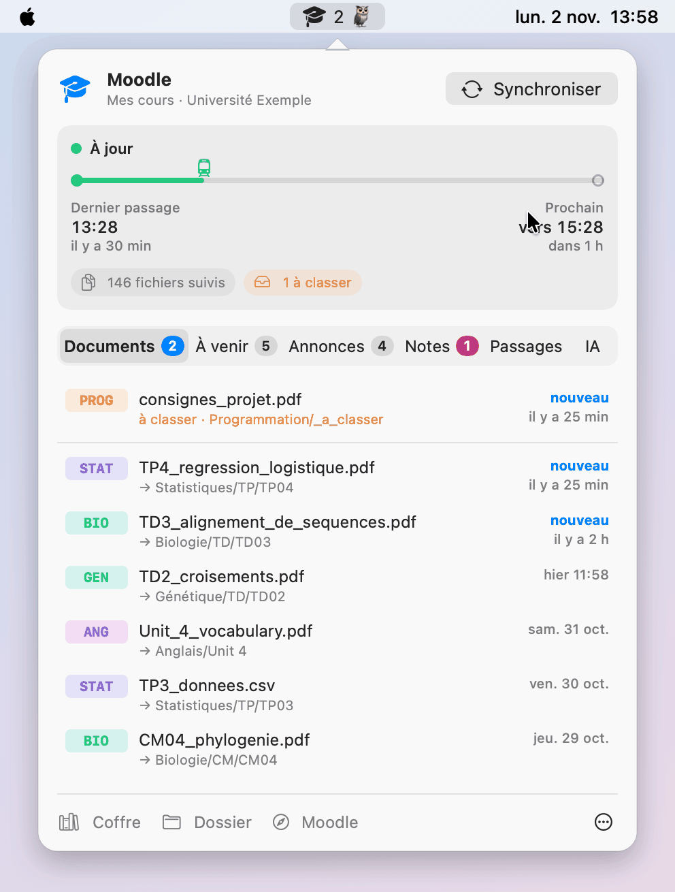
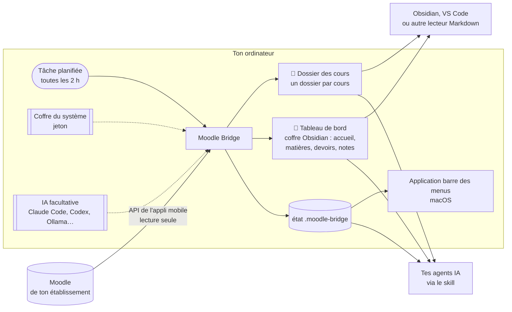

# Moodle Bridge

**Tes cours Moodle dans un dossier de ton ordinateur, à jour tout seul.**

Moodle Bridge se connecte à ton Moodle comme le fait l'appli mobile officielle et récupère automatiquement :
- les **documents** des cours (PDF, diaporamas, sujets, archives…), rangés dans un dossier par cours ;
- les **devoirs et échéances** ;
- les **annonces**, avec un résumé si une IA est branchée ;
- les **textes** de Moodle : consignes, pages, présentations des sections, modalités de contrôle.

Il tient à jour un **coffre Obsidian** bien rangé : une page d'accueil, une note par matière, une note par devoir, les annonces, les modalités de contrôle et tes notes en tableaux, avec un lien vers chaque fichier. Ces notes sont générées sans IA, à chaque passage.

- **Lecture seule** : rien n'est jamais déposé, posté ni marqué comme lu sur Moodle.
- **Rien n'est écrasé** : tes annotations dans un PDF restent intactes. Une nouvelle version arrive à côté de l'ancienne.
- **Python seul**, sans paquet à installer. macOS, et en théorie Windows et Linux ([non testés](#prérequis)).

<p align="center">
  <picture>
    <source media="(prefers-color-scheme: dark)" srcset="docs/img/demo-sombre.gif">
    
  </picture>
</p>

<p align="center">
  <em>L'application de barre des menus (macOS), avec des données fictives</em>
</p>

## Le plus rapide : confie l'installation à ton agent IA

Tu ne veux vraiment rien comprendre, juste que ça marche, et vite ? Soit, on ne juge pas. Enfin, un peu. Clone le dépôt et ouvre-le avec Claude Code, Codex ou Gemini CLI :

```bash
git clone https://github.com/ArthurArctique/Moodle-Bridge.git
cd Moodle-Bridge
claude      # ou codex, ou gemini
```

Puis demande-lui : *« Installe Moodle Bridge pour moi. »*

L'agent trouve ses consignes dans le dépôt ([`AGENTS.md`](AGENTS.md)). Il te pose quelques questions : ton Moodle, où ranger tes cours, avec ou sans IA. Ensuite il installe tout. Une seule étape te revient : la connexion à Moodle, dans ton propre terminal, pour que ton mot de passe ne passe jamais par l'agent.

Pendant qu'il travaille, tu pourrais lire la suite de ce README. Quelqu'un a passé des soirées à l'écrire, pour toi. Mais fais comme tu veux.

## Éditions

Le dépôt a plusieurs branches. Choisis la tienne :

| Branche | Pour qui | Contenu |
|---|---|---|
| **`main`** | tout le monde, clé en main | tout : synchronisation, IA facultative, application de barre des menus (macOS), notes, skill pour agents IA |
| [`cli-ia`](../../tree/cli-ia) | Windows, Linux, ou macOS sans application | synchronisation, IA facultative par ligne de commande, skill pour agents IA |
| [`outil`](../../tree/outil) | « juste la connexion » | synchronisation, rangement par section Moodle, coffre Obsidian ; aucune IA, aucune interface |
| [`skill`](../../tree/skill) | utilisateurs d'agents IA | le skill seul : ton agent (Claude Code, Codex…) te guide dans l'installation |

## Prérequis

> [!WARNING]
> **Windows et Linux : rien n'a été testé.** Je n'utilise Moodle Bridge que sur macOS. Tout ce qui concerne Windows et Linux (installation, coffre du système, tâche planifiée, notifications) a été écrit par une IA et n'a jamais été lancé sur ces systèmes : c'est théorique. Ça marchera peut-être, ou pas. Si tu essaies, raconte-moi dans une *issue*.

- **Python 3.9 ou plus récent** :
  - macOS : `python3 --version` dans le Terminal. S'il manque, macOS propose de l'installer, sinon passe par https://www.python.org/downloads/.
  - Windows : installe Python depuis https://www.python.org/downloads/ en cochant « Add python.exe to PATH ». Vérifie ensuite avec `py --version`.
  - Linux : déjà présent sur la plupart des distributions.
- **git**, ou le bouton *Code → Download ZIP* de GitHub.
- Un Moodle qui autorise l'**appli mobile** : c'est le cas de la plupart des établissements. L'installation le vérifie.

## Installation

```bash
git clone https://github.com/ArthurArctique/Moodle-Bridge.git
cd Moodle-Bridge
python3 install.py
```

Sous Windows, lance `py install.py` à la place de `python3 install.py`.

L'assistant pose quelques questions. Chacune a une valeur par défaut : Entrée la garde.

1. **L'adresse de ton Moodle** : copie celle de la barre d'adresse, n'importe quelle page de Moodle convient.
2. **Où ranger tes cours** : `~/Moodle` par défaut, ou un dossier de ton coffre Obsidian s'il en trouve un.
3. **Le coffre Obsidian** : le sous-dossier `Tableau de bord` de ton dossier de cours (« aucun » pour s'en passer).
4. **Une IA** pour ranger les fichiers ambigus et résumer les annonces : facultatif, voir [IA](#ia-facultative).
5. **La fréquence** de synchronisation : toutes les 2 h par défaut.
6. **La connexion à Moodle**, voir juste en dessous.
7. **Les cours à suivre** : tous par défaut, tu peux en exclure.
8. **Pour finir** : première synchronisation, synchronisation automatique, puis selon l'édition l'application macOS et le skill pour tes agents IA.

Tu peux relancer `install.py` quand tu veux, par exemple pour ajouter des cours ou activer l'IA. L'installation est mise à jour sans rien perdre.

## Première connexion à Moodle

Moodle Bridge ne garde **jamais ton mot de passe**. Il obtient de Moodle un *jeton*, la même clé que celle de l'appli mobile, et le range dans le coffre-fort de ton système :
- le Trousseau sous macOS ;
- le Gestionnaire d'identification sous Windows ;
- le trousseau de session sous Linux.

L'assistant choisit la bonne méthode selon ton Moodle. Tu peux la changer plus tard avec `token --method …`.

### Tu te connectes à Moodle avec un identifiant et un mot de passe Moodle

L'assistant te les demande dans le terminal. Le mot de passe ne s'affiche pas pendant la saisie, c'est normal. Il sert une seule fois à obtenir le jeton, puis il est oublié.

```text
Identifiant Moodle : jdupont
Mot de passe (rien ne s'affiche, c'est normal) :
Jeton enregistré : Trousseau macOS (service « moodle-bridge:moodle.mon-universite.fr »).
  ✓ Connecté à Moodle de mon université en tant que Jeanne Dupont
```

### Tu passes par une page de connexion de ton établissement (CAS, ENT, Shibboleth, compte Microsoft…)

Ton mot de passe ne transite pas par Moodle, donc il faut passer par le navigateur, comme le fait l'appli mobile. Compte une minute :

1. Connecte-toi à Moodle dans ton navigateur, comme d'habitude.
2. Ouvre les **outils de développement** : `Cmd+Option+I` sur Mac, `F12` sous Windows et Linux. Va dans l'onglet **Réseau** (*Network*) et coche **Conserver le journal** (*Preserve log*).
3. Dans ce même onglet, colle l'adresse affichée par l'assistant. La page semble ne rien faire, c'est normal. Si le navigateur propose d'ouvrir l'appli Moodle, refuse.
4. Tape `token` dans le filtre de l'onglet Réseau. Fais un clic droit sur la ligne `moodlemobile://token=…`, puis *Copier → Copier l'URL*.
5. Reviens au terminal et appuie sur Entrée : l'assistant lit le presse-papiers, vérifie la signature, enregistre le jeton et vide le presse-papiers.

### Autre possibilité : la clé de sécurité

Certains Moodle affichent la clé dans *Profil → Préférences → Clés de sécurité*. Copie celle de la ligne « Moodle mobile web service », pas la clé RSS, puis lance `token --method key`.

Guide détaillé et cas particuliers : [docs/premiere-connexion.md](docs/premiere-connexion.md).

Si le jeton expire (`jeton refusé` dans l'accueil du coffre ou une notification), relance simplement :

```bash
python3 scripts/moodle_bridge.py token --config ~/Moodle/.moodle-bridge/config.json
```

## Lire tes données : le coffre Obsidian

Tout ce que produit Moodle Bridge est un dossier de fichiers ordinaires : tes documents, rangés par cours, et un **coffre Obsidian** dans `Tableau de bord/`.

| Note | Contenu |
|---|---|
| `Accueil` | la semaine à venir, les annonces récentes, les nouveaux documents, ce qui attend une action, le tableau des matières |
| `Matières/<CODE>` | une note par matière : échéances, annonces, modalités de contrôle, notes, puis tout le contenu section par section (textes, documents, devoirs) |
| `Devoirs/<CODE> — <devoir>` | date limite, consignes, pièces jointes et lien de dépôt |
| `Échéances`, `Annonces`, `Documents`, `Modalités de contrôle` | les mêmes informations, tous cours confondus |
| `Notes` | tes notes en tableaux, par matière (édition `main`, si le relevé des notes est activé) |

Ces notes sont **déterministes** : aucune IA ne les écrit. Elles sont régénérées à chaque passage à partir de ce que Moodle renvoie, et réécrites seulement quand leur contenu change. Leurs propriétés (matière, date limite, statut…) servent aux recherches et aux bases d'Obsidian. Le résumé d'une annonce n'apparaît que si une IA l'a déjà fait. Une note encore « mystère » n'y montre jamais sa valeur.

**Tes propres notes ne sont jamais touchées**, même posées dans `Tableau de bord/` : le pont ne modifie et ne supprime que les notes qui portent sa propriété `genere_par: moodle-bridge`.

**[Obsidian](https://obsidian.md)** (gratuit) est le plus confortable pour naviguer dans ces données. Ouvre ton dossier de cours comme un *coffre* (*Ouvrir un dossier comme coffre*), puis la note `Tableau de bord/Accueil`. Tu y gagnes :
- des liens entre accueil, matières et devoirs, et vers chaque PDF et chaque page Moodle ;
- l'ouverture des PDF dans Obsidian même, pour lire sans changer d'application ;
- la recherche plein texte dans les consignes, les annonces et les modalités de contrôle de tous les cours ;
- tes propres notes à côté des cours, avec des liens vers les documents synchronisés ;
- la mise à jour en direct après chaque synchronisation.

**Obsidian n'est pas obligatoire.** Si tu ne l'as pas, les fichiers sont créés exactement pareil. Tu peux les ouvrir avec :
- **VS Code** : ouvre le dossier, puis `Ctrl+Maj+V` (`Cmd+Maj+V` sur Mac) affiche l'aperçu du Markdown ;
- **Typora**, **MarkText**, **Zettlr** ou tout autre éditeur Markdown ;
- ton explorateur de fichiers, pour les documents eux-mêmes : ils sont rangés dans des dossiers lisibles, un par cours.

Tes agents IA (Claude Code, Codex…) lisent aussi ces fichiers directement : voir [Agents IA](#agents-ia-skill).

## Architecture



1. **La tâche planifiée** lance Moodle Bridge toutes les 2 h. Selon le système, c'est launchd sur macOS, le Planificateur de tâches sur Windows et cron sur Linux. Un passage manqué, ordinateur éteint ou en veille, est rattrapé au réveil.
2. **Moodle Bridge** demande à Moodle ce qui a changé, avec le jeton rangé dans le coffre du système. Il télécharge les nouveaux documents et les range dans ton dossier.
3. **Le rangement** se fait par section Moodle, ou par séance (CM/TD/TP) avec l'aide d'une IA. Un fichier incertain va dans `_a_classer/` plutôt que dans un mauvais dossier.
4. **Le coffre Obsidian** est régénéré à chaque passage, sans IA. Ne modifie pas ses notes : les tiennes vont dans tes propres fichiers.
5. **Tu lis** le tout dans Obsidian ou VS Code. **Tes agents IA** y accèdent grâce au skill. **L'application de barre des menus** (macOS) affiche l'état et les nouveautés sans jamais contacter Moodle elle-même.

Le fonctionnement interne (modules, état, règles de rangement) est décrit dans [`docs/architecture.md` de la branche `outil`](../../blob/outil/docs/architecture.md), et pour les agents dans [skill/references/](skill/references/).

## Au quotidien

Il n'y a rien à faire : la synchronisation tourne toute seule. Ouvre la note `Accueil` du coffre pour voir les nouveautés. Pour agir à la main :

```bash
# remplace ~/Moodle par ton dossier de cours
python3 scripts/moodle_bridge.py sync    --config ~/Moodle/.moodle-bridge/config.json   # synchroniser maintenant
python3 scripts/moodle_bridge.py status  --config ~/Moodle/.moodle-bridge/config.json   # état, retard, fichiers à classer
python3 scripts/moodle_bridge.py courses --config ~/Moodle/.moodle-bridge/config.json   # cours suivis (--add-all : en ajouter)
python3 scripts/moodle_bridge.py texts   --config ~/Moodle/.moodle-bridge/config.json --mcc   # modalités de contrôle
```

- **Un fichier dans `_a_classer/`** : déplace-le où tu veux, la synchronisation suivante le retrouve par son empreinte.
- **Un fichier mal rangé** : déplace-le aussi. Rien n'est retéléchargé.
- **Un nouveau semestre** : relance `install.py`, ou utilise `courses --add-all`.
- **Les réglages** sont dans `.moodle-bridge/config.json` : voir [docs/configuration.md](docs/configuration.md).

## IA (facultative)

Sans IA, chaque cours est rangé par section Moodle, ce qui suffit souvent. Avec une IA, les fichiers sont rangés par séance (`CM/CM01`, `TD/TD03`, `TP/TP02`…), même quand Moodle les présente autrement. Les annonces longues sont aussi résumées en quelques lignes.

Moodle Bridge n'a **aucune clé d'API à configurer**. Il passe par une ligne de commande que tu utilises déjà :
- **Claude Code** (`claude`) : ton abonnement Claude, petit modèle Haiku par défaut ;
- **Codex** (`codex`) : ton compte ChatGPT ;
- **toute autre commande** qui lit une demande et répond, par exemple `ollama run llama3.2` pour une IA 100 % locale.

**Ce qui est envoyé** : les noms des fichiers et des sections, l'arborescence du cours et le texte des annonces. Le contenu des documents n'est jamais envoyé. Un passage sans nouveauté ne consomme rien. Détails : [docs/ia.md](docs/ia.md).

### Changer d'IA ou de modèle

Trois façons, au choix :
- **Application macOS** : onglet **IA** du menu Moodle Bridge. Clique sur une IA, puis choisis le modèle dans la liste. Une IA installée mais pas connectée affiche **Se connecter…**, qui ouvre la connexion dans un terminal.
- **Double-clic** sur `Choisir-IA.command` (macOS) ou `Choisir-IA.bat` (Windows), à la racine du dépôt. Le lanceur montre les IA installées et connectées, propose de se connecter, liste les modèles, puis fait un essai.
- **Terminal** : `python3 scripts/moodle_bridge.py ai` pose les mêmes questions ; `ai status`, `ai set --engine claude-cli --model sonnet` et `ai test` font chaque étape séparément.

Le modèle choisi sert à tout : rangement, résumés des annonces et énigmes des notes.

## Agents IA (skill)

Les éditions `main` et `cli-ia` installent un **skill**, c'est-à-dire un mode d'emploi pour Claude Code, Codex ou tout agent qui lit les fichiers `SKILL.md`. Ton agent sait alors :
- où sont tes cours, le coffre Obsidian et les réglages ;
- quelles commandes lancer ;
- quoi modifier selon ta demande.

Tu peux lui demander « qu'est-ce que j'ai à rendre cette semaine ? », « synchronise Moodle », « range ce fichier » ou « comment est calculée la note de cette UE ? ».

```bash
python3 scripts/moodle_bridge.py skill install --config ~/Moodle/.moodle-bridge/config.json --target claude   # ou codex, both
```

Pour un autre agent, utilise `--dest <dossier de skills de l'agent>`. Tu n'as pas encore installé Moodle Bridge ? La branche [`skill`](../../tree/skill) contient un skill d'amorçage : ton agent te pose les bonnes questions et fait l'installation avec toi.

## Application de barre des menus (macOS)

L'application affiche dans la barre des menus :
- une icône d'état : à jour, en cours, en retard ou en échec ;
- le nombre de nouveaux documents ;
- un panneau avec les derniers documents, les échéances et les annonces (résumé au clic) ;
- les nouvelles notes publiées sur Moodle, en « mystère » jusqu'à ce que tu cliques pour les découvrir (facultatif, `notes.enabled`) ;
- un onglet **IA** pour changer d'IA ou de modèle, et s'y connecter ;
- un bouton « Synchroniser », et un bouton « Coffre » qui ouvre l'accueil dans Obsidian.

Elle est compilée sur ta machine pendant l'installation, ce qui demande les outils de développement d'Apple : `xcode-select --install`. Voir [docs/application-macos.md](docs/application-macos.md).

## Sécurité et vie privée

- Le jeton reste dans le coffre-fort de ton système. Il n'est jamais écrit dans un fichier, ni dans les journaux, ni dans le coffre Obsidian. Tous les liens sont nettoyés du jeton.
- Le mot de passe, si tu choisis cette méthode, sert une seule fois et n'est jamais stocké.
- Moodle Bridge ne parle qu'à ton Moodle. Il ne contacte une IA que si tu l'as choisi, et uniquement par la ligne de commande que tu as désignée.
- Le dossier `.moodle-bridge/` (réglages, état, journaux) contient ton adresse Moodle et la liste de tes cours. Il est exclu de git par défaut : ne le publie pas.

## Désinstaller

```bash
python3 scripts/moodle_bridge.py uninstall --config ~/Moodle/.moodle-bridge/config.json
```

Cette commande retire la synchronisation automatique et le jeton. Tes fichiers restent en place. Ensuite, si tu veux tout effacer :
- l'application macOS : `menubar uninstall` ;
- le skill : supprime son dossier dans `~/.claude/skills` ou `~/.codex/skills` ;
- le reste : supprime le dossier du dépôt, puis `.moodle-bridge/` dans ton dossier de cours.

## Dépannage

Voir [docs/depannage.md](docs/depannage.md). Le premier réflexe est `status`, qui donne le dernier succès, le dernier échec et l'état de la tâche planifiée.

> **Windows et Linux** : jamais testés, voir l'avertissement des [Prérequis](#prérequis). Si quelque chose casse, signale-le dans une *issue*.

## Licence

[MIT](LICENSE).
