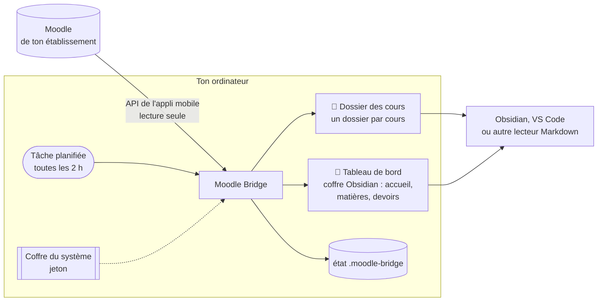

# Moodle Bridge

**Tes cours Moodle dans un dossier de ton ordinateur, à jour tout seul.** Édition `outil` : la connexion et la synchronisation, sans IA ni interface.

Moodle Bridge se connecte à ton Moodle comme le fait l'appli mobile officielle et récupère automatiquement :
- les **documents** des cours (PDF, diaporamas, sujets, archives…), rangés dans un dossier par cours ;
- les **devoirs et échéances** ;
- les **annonces** ;
- les **textes** de Moodle : consignes, pages, présentations des sections, modalités de contrôle.

Il tient à jour un **coffre Obsidian** bien rangé : une page d'accueil, une note par matière, une note par devoir, les annonces et les modalités de contrôle, avec un lien vers chaque fichier. Ces notes sont régénérées à chaque passage.

- **Lecture seule** : rien n'est jamais déposé, posté ni marqué comme lu sur Moodle.
- **Rien n'est écrasé** : tes annotations dans un PDF restent intactes. Une nouvelle version arrive à côté de l'ancienne.
- **Python seul**, sans paquet à installer. macOS, Windows et Linux.

## Éditions

Le dépôt a plusieurs branches. Tu es sur **`outil`** :

| Branche | Pour qui | Contenu |
|---|---|---|
| [`main`](../../tree/main) | tout le monde, clé en main | tout : synchronisation, IA facultative, application de barre des menus (macOS), notes, skill pour agents IA |
| [`cli-ia`](../../tree/cli-ia) | Windows, Linux, ou macOS sans application | synchronisation, IA facultative par ligne de commande, skill pour agents IA |
| [`outil`](../../tree/outil) | « juste la connexion » | synchronisation, rangement par section Moodle, coffre Obsidian ; aucune IA, aucune interface |
| [`skill`](../../tree/skill) | utilisateurs d'agents IA | le skill seul : ton agent (Claude Code, Codex…) te guide dans l'installation |

## Prérequis

- **Python 3.9 ou plus récent** :
  - macOS : `python3 --version` dans le Terminal. S'il manque, macOS propose de l'installer, sinon passe par https://www.python.org/downloads/.
  - Windows : installe Python depuis https://www.python.org/downloads/ en cochant « Add python.exe to PATH ». Vérifie ensuite avec `py --version`.
  - Linux : déjà présent sur la plupart des distributions.
- **git**, ou le bouton *Code → Download ZIP* de GitHub.
- Un Moodle qui autorise l'**appli mobile** : c'est le cas de la plupart des établissements. L'installation le vérifie.

## Installation

```bash
git clone --branch outil https://github.com/ArthurArctique/Moodle-Bridge.git
cd Moodle-Bridge
python3 install.py
```

Sous Windows, lance `py install.py` à la place de `python3 install.py`.

L'assistant pose quelques questions. Chacune a une valeur par défaut : Entrée la garde.

1. **L'adresse de ton Moodle** : copie celle de la barre d'adresse, n'importe quelle page de Moodle convient.
2. **Où ranger tes cours** : `~/Moodle` par défaut, ou un dossier de ton coffre Obsidian s'il en trouve un.
3. **Le coffre Obsidian** : le sous-dossier `Tableau de bord` de ton dossier de cours (« aucun » pour s'en passer).
4. **La fréquence** de synchronisation : toutes les 2 h par défaut.
5. **La connexion à Moodle**, voir juste en dessous.
6. **Les cours à suivre** : tous par défaut, tu peux en exclure. Chaque cours est rangé par section Moodle.
7. **Pour finir** : première synchronisation, puis synchronisation automatique.

Tu peux relancer `install.py` quand tu veux, par exemple pour ajouter des cours. L'installation est mise à jour sans rien perdre.

## Première connexion à Moodle

Moodle Bridge ne garde **jamais ton mot de passe**. Il obtient de Moodle un *jeton*, la même clé que celle de l'appli mobile, et le range dans le coffre-fort de ton système :
- le Trousseau sous macOS ;
- le Gestionnaire d'identification sous Windows ;
- le trousseau de session sous Linux.

L'assistant choisit la bonne méthode selon ton Moodle. Tu peux la changer plus tard avec `token --method …`.

### Tu te connectes à Moodle avec un identifiant et un mot de passe Moodle

L'assistant te les demande dans le terminal. Le mot de passe ne s'affiche pas pendant la saisie, c'est normal. Il sert une seule fois à obtenir le jeton, puis il est oublié.

```text
Identifiant Moodle : jdupont
Mot de passe (rien ne s'affiche, c'est normal) :
Jeton enregistré : Trousseau macOS (service « moodle-bridge:moodle.mon-universite.fr »).
  ✓ Connecté à Moodle de mon université en tant que Jeanne Dupont
```

### Tu passes par une page de connexion de ton établissement (CAS, ENT, Shibboleth, compte Microsoft…)

Ton mot de passe ne transite pas par Moodle, donc il faut passer par le navigateur, comme le fait l'appli mobile. Compte une minute :

1. Connecte-toi à Moodle dans ton navigateur, comme d'habitude.
2. Ouvre les **outils de développement** : `Cmd+Option+I` sur Mac, `F12` sous Windows et Linux. Va dans l'onglet **Réseau** (*Network*) et coche **Conserver le journal** (*Preserve log*).
3. Dans ce même onglet, colle l'adresse affichée par l'assistant. La page semble ne rien faire, c'est normal. Si le navigateur propose d'ouvrir l'appli Moodle, refuse.
4. Tape `token` dans le filtre de l'onglet Réseau. Fais un clic droit sur la ligne `moodlemobile://token=…`, puis *Copier → Copier l'URL*.
5. Reviens au terminal et appuie sur Entrée : l'assistant lit le presse-papiers, vérifie la signature, enregistre le jeton et vide le presse-papiers.

### Autre possibilité : la clé de sécurité

Certains Moodle affichent la clé dans *Profil → Préférences → Clés de sécurité*. Copie celle de la ligne « Moodle mobile web service », pas la clé RSS, puis lance `token --method key`.

Guide détaillé et cas particuliers : [docs/premiere-connexion.md](docs/premiere-connexion.md).

Si le jeton expire (`jeton refusé` dans l'accueil du coffre ou une notification), relance simplement :

```bash
python3 scripts/moodle_bridge.py token --config ~/Moodle/.moodle-bridge/config.json
```

## Lire tes données : le coffre Obsidian

Tout ce que produit Moodle Bridge est un dossier de fichiers ordinaires : tes documents, rangés par cours, et un **coffre Obsidian** dans `Tableau de bord/`.

| Note | Contenu |
|---|---|
| `Accueil` | la semaine à venir, les annonces récentes, les nouveaux documents, ce qui attend une action, le tableau des matières |
| `Matières/<CODE>` | une note par matière : échéances, annonces, modalités de contrôle, puis tout le contenu section par section (textes, documents, devoirs) |
| `Devoirs/<CODE> — <devoir>` | date limite, consignes, pièces jointes et lien de dépôt |
| `Échéances`, `Annonces`, `Documents`, `Modalités de contrôle` | les mêmes informations, tous cours confondus |

Ces notes sont **déterministes**. Elles sont régénérées à chaque passage à partir de ce que Moodle renvoie, et réécrites seulement quand leur contenu change. Leurs propriétés (matière, date limite, statut…) servent aux recherches et aux bases d'Obsidian.

**Tes propres notes ne sont jamais touchées**, même posées dans `Tableau de bord/` : le pont ne modifie et ne supprime que les notes qui portent sa propriété `genere_par: moodle-bridge`.

**[Obsidian](https://obsidian.md)** (gratuit) est le plus confortable pour naviguer dans ces données. Ouvre ton dossier de cours comme un *coffre* (*Ouvrir un dossier comme coffre*), puis la note `Tableau de bord/Accueil`. Tu y gagnes :
- des liens entre accueil, matières et devoirs, et vers chaque PDF et chaque page Moodle ;
- l'ouverture des PDF dans Obsidian même, pour lire sans changer d'application ;
- la recherche plein texte dans les consignes, les annonces et les modalités de contrôle de tous les cours ;
- tes propres notes à côté des cours, avec des liens vers les documents synchronisés ;
- la mise à jour en direct après chaque synchronisation.

**Obsidian n'est pas obligatoire.** Si tu ne l'as pas, les fichiers sont créés exactement pareil. Tu peux les ouvrir avec :
- **VS Code** : ouvre le dossier, puis `Ctrl+Maj+V` (`Cmd+Maj+V` sur Mac) affiche l'aperçu du Markdown ;
- **Typora**, **MarkText**, **Zettlr** ou tout autre éditeur Markdown ;
- ton explorateur de fichiers, pour les documents eux-mêmes : ils sont rangés dans des dossiers lisibles, un par cours.

Ce sont des fichiers ordinaires : n'importe quel outil peut les lire, y compris un agent IA ou tes propres scripts. Le format de l'état est décrit dans [docs/architecture.md](docs/architecture.md#létat-statejson).

## Architecture



1. **La tâche planifiée** lance Moodle Bridge toutes les 2 h. Selon le système, c'est launchd sur macOS, le Planificateur de tâches sur Windows et cron sur Linux. Un passage manqué, ordinateur éteint ou en veille, est rattrapé au réveil.
2. **Moodle Bridge** demande à Moodle ce qui a changé, avec le jeton rangé dans le coffre du système. Il télécharge les nouveaux documents et les range dans ton dossier, un sous-dossier par section Moodle.
3. **Le coffre Obsidian** est régénéré à chaque passage. Ne modifie pas ses notes : les tiennes vont dans tes propres fichiers.
4. **Tu lis** le tout dans Obsidian, VS Code ou ton explorateur de fichiers.

Le fonctionnement interne est décrit dans [docs/architecture.md](docs/architecture.md) :
- les modules ;
- les fichiers et l'état ;
- le déroulement d'un passage ;
- les règles de rangement ;
- les fonctions de l'API Moodle utilisées ;
- tous les réglages.

## Au quotidien

Il n'y a rien à faire : la synchronisation tourne toute seule. Ouvre la note `Accueil` du coffre pour voir les nouveautés. Pour agir à la main :

```bash
# remplace ~/Moodle par ton dossier de cours
python3 scripts/moodle_bridge.py sync    --config ~/Moodle/.moodle-bridge/config.json   # synchroniser maintenant
python3 scripts/moodle_bridge.py status  --config ~/Moodle/.moodle-bridge/config.json   # état, retard, fichiers à classer
python3 scripts/moodle_bridge.py courses --config ~/Moodle/.moodle-bridge/config.json   # cours suivis (--add-all : en ajouter)
python3 scripts/moodle_bridge.py texts   --config ~/Moodle/.moodle-bridge/config.json --mcc   # modalités de contrôle
```

- **Un fichier mal rangé** : déplace-le aussi. Rien n'est retéléchargé.
- **Un nouveau semestre** : relance `install.py`, ou utilise `courses --add-all`.
- **Les réglages** sont dans `.moodle-bridge/config.json` : voir [docs/configuration.md](docs/configuration.md).

## Sécurité et vie privée

- Le jeton reste dans le coffre-fort de ton système. Il n'est jamais écrit dans un fichier, ni dans les journaux, ni dans le coffre Obsidian. Tous les liens sont nettoyés du jeton.
- Le mot de passe, si tu choisis cette méthode, sert une seule fois et n'est jamais stocké.
- Moodle Bridge ne parle qu'à ton Moodle. Aucune autre connexion, aucune IA dans cette édition.
- Le dossier `.moodle-bridge/` (réglages, état, journaux) contient ton adresse Moodle et la liste de tes cours. Il est exclu de git par défaut : ne le publie pas.

## Désinstaller

```bash
python3 scripts/moodle_bridge.py uninstall --config ~/Moodle/.moodle-bridge/config.json
```

Cette commande retire la synchronisation automatique et le jeton. Tes fichiers restent en place. Pour tout effacer, supprime ensuite le dossier du dépôt, puis `.moodle-bridge/` dans ton dossier de cours.

## Dépannage

Voir [docs/depannage.md](docs/depannage.md). Le premier réflexe est `status`, qui donne le dernier succès, le dernier échec et l'état de la tâche planifiée.

> **Windows et Linux** : le support est récent. La synchronisation, le coffre du système et la tâche planifiée sont prévus pour ces systèmes, mais ils ont surtout été éprouvés sur macOS. Signale tout souci dans une *issue*.

## Licence

[MIT](LICENSE).
