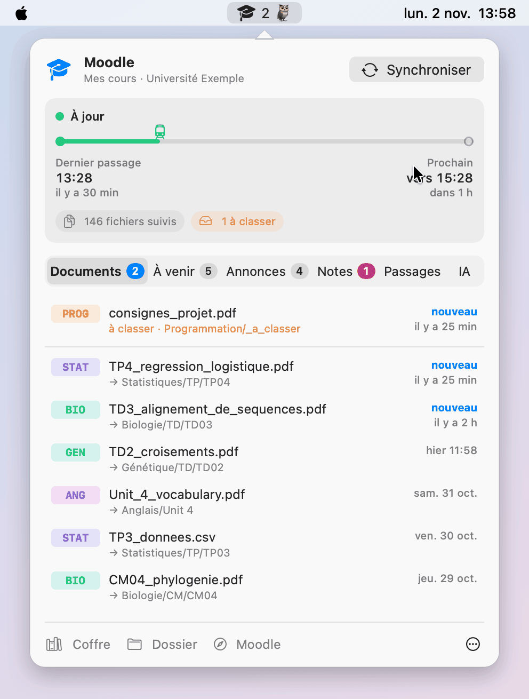

# Application de barre des menus (macOS, édition `main`)

Une petite icône dans la barre des menus. Un clic ouvre un panneau. Une fenêtre n'apparaît que pour installer Moodle Bridge ou te reconnecter à Moodle.

<p align="center">
  <picture>
    <source media="(prefers-color-scheme: dark)" srcset="img/demo-sombre.gif">
    
  </picture>
</p>

## Ce qu'elle affiche

- **L'icône** :
  - à jour ;
  - nombre de nouveaux documents depuis la dernière ouverture du panneau ;
  - synchronisation en cours ;
  - en retard (aucun passage réussi depuis longtemps) ;
  - en échec : Moodle injoignable ou jeton expiré, la raison est dans le panneau.
- **Essentiel** (l'icône de maison, premier onglet) : ce qui compte en ce moment, sans IA.
  - les problèmes que l'état du pont n'affiche pas : classement automatique en panne, relevé des notes en échec ;
  - les notes à découvrir ;
  - les **changements annoncés** : report, annulation, salle, distanciel, campus bloqué… ;
  - les échéances des 7 prochains jours, avec une toque pour les évaluations ;
  - les **examens et évaluations** : annonces des 14 derniers jours qui en parlent (convocation, partiel, CC, oral, restitution…), échéances jusqu'à 30 jours.

  Les annonces sont triées sur leur titre, par mots-clés : un titre qui annonce un changement (« Report des CC ») compte comme changement, pas comme examen. C'est le même résumé que la section « L'essentiel » de l'accueil du coffre.
- **Documents** : les derniers arrivés et le dossier où ils ont été rangés, un clic pour les ouvrir.
- **Échéances** : devoirs et événements à venir.
- **Annonces** : un clic affiche le résumé (ou le texte d'une annonce courte), un autre ouvre l'annonce sur Moodle. Le compteur de l'onglet ne montre que les annonces pas encore affichées : il disparaît dès que tu as ouvert l'onglet.
- **Notes** (si activées) : une nouvelle note arrive en **mystère**, avec un emoji, une couleur et une énigme. Sa valeur ne s'affiche qu'au clic sur « Découvrir ».
- **IA** : l'IA utilisée et son modèle, à changer d'un clic. Voir [Changer de modèle](ia.md#changer-de-modèle).
- **Historique** des derniers passages et bouton **Synchroniser**, qui lance tout de suite la tâche planifiée.

Quand les titres des onglets et leurs compteurs ne tiennent pas dans la largeur du panneau, Passages et IA passent en icônes, puis tous les onglets ; leur nom s'affiche au survol.
- **Coffre** : ouvre la note d'accueil du coffre Obsidian. Si Obsidian ne connaît pas encore ce coffre, la note s'ouvre dans l'éditeur par défaut et le panneau indique quel dossier ouvrir comme coffre.

Le panneau **ne contacte jamais Moodle** : il lit l'état que Moodle Bridge écrit dans `~/Library/Caches/moodle-bridge/` à chaque passage. Une seule application sert toutes les installations du Mac. Elle ne fait que lancer des commandes du pont :
- l'onglet IA : `ai status`, `ai set`, `ai test`, qui interrogent Claude Code, Codex ou Gemini sur ta machine ;
- la fenêtre d'installation : `check-site`, `init`, `token`. C'est le pont qui contacte Moodle et range le jeton dans le Trousseau. L'application lui transmet ta réponse de connexion par l'entrée standard, sans la garder ni l'afficher.

## Installation

### Télécharger l'application (le plus simple)

1. Télécharge [Moodle-Bridge-macOS.zip](https://github.com/ArthurArctique/Moodle-Bridge/releases/latest/download/Moodle-Bridge-macOS.zip), ouvre-le et glisse **Moodle Bridge** dans **Applications**.
2. Ouvre-la. La première fois, macOS refuse : l'application est signée localement, pas par un compte développeur Apple. Va dans **Réglages Système › Confidentialité et sécurité** et clique sur **Ouvrir quand même**.
3. La fenêtre d'installation s'ouvre (voir plus bas).

L'application embarque le pont. Elle le recopie dans `~/Library/Application Support/Moodle Bridge/bridge`, et la tâche planifiée le lance depuis là : déplacer l'application ne casse rien. Il faut macOS 13 ou plus récent et Python 3.9 ou plus récent. S'il manque, la fenêtre propose d'installer les outils d'Apple, qui le fournissent.

**Mettre à jour** : remplace l'application dans Applications par la nouvelle version. Au lancement suivant, elle recopie son pont si la version a changé. Tes réglages, tes cours et ton jeton ne bougent pas.

### La compiler depuis le dépôt

L'assistant (`install.py`) la propose à la fin de l'installation. Sinon :

```bash
python3 scripts/moodle_bridge.py menubar install --config ~/Moodle/.moodle-bridge/config.json
```

- Elle est **compilée sur ta machine**, en une dizaine de secondes. Il faut macOS 13 ou plus récent et les outils de développement d'Apple : `xcode-select --install`, une fois.
- Elle s'installe dans `~/Applications/Moodle Bridge.app` et se lance. Sa fenêtre d'installation lance alors le pont du dépôt.
- Après une mise à jour du dépôt (`git pull`), relance `menubar install` pour recompiler.
- `menubar uninstall` la supprime.

**Ouverture à la connexion** : menu ⋯ du panneau, « Ouvrir à la connexion ». macOS peut demander de confirmer dans *Réglages Système → Général → Ouverture*.

## La fenêtre d'installation

Elle s'ouvre au premier lancement s'il n'existe encore aucune installation, et à tout moment par « Ajouter un Moodle… » dans le menu ⋯ du panneau. Elle enchaîne :

1. **Bienvenue** : vérifie Python et l'emplacement de l'application. Lancée depuis le zip ou Téléchargements, macOS l'exécute depuis un emplacement temporaire : il faut d'abord la ranger dans Applications.
2. **Ton Moodle** : colle l'adresse de n'importe quelle page du site, puis « Vérifier ».
3. **Dossiers** : où ranger les cours (`~/Moodle`, ou un dossier de ton coffre Obsidian) et le sous-dossier des notes Obsidian. Documents, Bureau, iCloud et OneDrive sont signalés : macOS y bloque la synchronisation en arrière-plan sans autorisation.
4. **IA** : aucune, Claude Code, Codex ou Gemini, avec le modèle et le mode de rangement.
5. **Connexion** : par le navigateur, par identifiant et mot de passe, ou par clé de sécurité. Voir [Première connexion](premiere-connexion.md#depuis-lapplication-macos).
6. **Cours** : tous cochés, décoche ceux à laisser de côté.
7. **Options** : fréquence, première synchronisation, ouverture à la connexion, skill pour tes agents IA.
8. **Installation** : la progression s'affiche ligne à ligne, puis un récapitulatif.

Choisir un dossier qui contient déjà une installation la met à jour : ses cours et ses réglages sont conservés.

## Jeton expiré

Quand Moodle refuse le jeton, le panneau propose « Renouveler le jeton… ». La fenêtre s'ouvre directement sur l'étape Connexion de l'installation concernée, et une synchronisation suit la reconnexion. Avec un pont trop ancien pour la connexion dans la fenêtre, elle propose la commande `token` dans un terminal.

## Je ne vois pas l'icône

Si `pgrep -x MoodleBridge` affiche un numéro, l'application tourne, mais son icône est cachée par l'une de ces causes :
- **manque de place** : macOS masque d'abord les icônes les plus éloignées de l'horloge quand l'application au premier plan a beaucoup de menus. Essaie depuis le Finder ;
- une application **en plein écran** : la barre des menus n'apparaît qu'au survol du haut de l'écran ;
- un **gestionnaire de barre des menus** (Bartender, Ice…) : fais passer l'icône dans la partie visible.

Sinon, relance-la : `open "/Applications/Moodle Bridge.app"` (application téléchargée) ou `open ~/Applications/Moodle\ Bridge.app` (application compilée).

## Refaire l'animation

L'animation de cette page et du README se refait après une modification de l'interface :

```bash
python3 menubar/demo/make_gif.py
```

Le script compile l'application en mode démo (`menubar/demo/Demo.swift`), la fait jouer hors de l'écran avec des données fictives, puis écrit `docs/img/demo-clair.gif` et `docs/img/demo-sombre.gif`. Il faut [Pillow](https://pypi.org/project/pillow/) : `python3 -m pip install pillow`. Ni l'état du pont ni l'application installée ne sont touchés.
