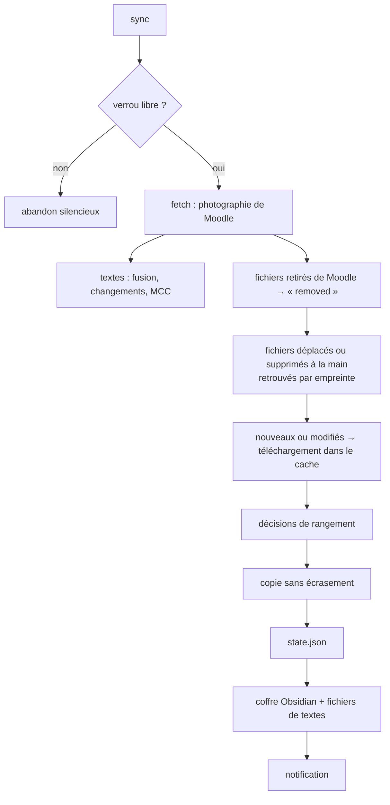

# Architecture

Comment Moodle Bridge fonctionne de l'intérieur. Ce document s'adresse aux personnes qui veulent comprendre le code, le modifier ou l'intégrer à autre chose. Pour simplement l'utiliser, le [README](../README.md) suffit.

## Principes

- **Lecture seule** côté Moodle : le pont n'appelle que des fonctions de lecture de l'API de l'appli mobile.
- **Déterministe** : interroger, comparer, télécharger, ranger et écrire l'index se fait sans aucun modèle de langage. Dans les éditions qui en ont un, il n'intervient que pour choisir un dossier quand aucune règle sûre ne s'applique, et pour résumer des annonces.
- **Jamais d'écrasement** : un fichier local n'est jamais remplacé ni modifié. Une nouvelle version arrive à côté.
- **État explicite** : tout ce que le pont sait est dans `state.json`. L'index et les textes sont reconstruits à partir de lui.
- **Bibliothèque standard Python** (3.9+), sans dépendance.

## Modules

`scripts/moodle_bridge.py` est le point d'entrée : une sous-commande par action, analyse des arguments, verrou, gestion des erreurs, notifications. Le travail est fait par le paquet `scripts/mb/` :

| Module | Rôle |
|---|---|
| `api.py` | client REST minimal de Moodle (`/webservice/rest/server.php`), configuration publique du site, téléchargement en flux avec contrôle de taille ; `TokenError` pour un jeton refusé |
| `credentials.py` | jeton : lecture et écriture dans le coffre du système, première connexion par mot de passe, par le navigateur (`launch.php`, vérification de signature) ou par collage d'une clé |
| `fetch.py` | photographie du Moodle distant : cours, fichiers, textes, devoirs, échéances, annonces |
| `sync.py` | un passage : comparaison avec l'état, téléchargement dans le cache, décisions de rangement, copie sans écrasement, mise à jour de l'état ; verrou et plan de simulation |
| `classify.py` | règles de rangement : miroir, voisins, validation d'une destination, et dans les éditions avec IA, la demande au modèle |
| `texts.py` | textes Moodle : HTML → Markdown, empreintes, détection des changements et des modalités de contrôle, un fichier par cours |
| `summaries.py` | résumés d'annonces ; sans modèle, garde le texte d'une annonce courte ou son début |
| `vault.py` | coffre Obsidian : accueil, une note par matière (`Matières/`), une par devoir (`Devoirs/`), échéances, annonces, documents, modalités de contrôle ; liens Obsidian, propriétés, aucune réécriture d'une note inchangée, aucune suppression d'une note non générée |
| `index.py` | ancien tableau de bord en un seul fichier (facultatif) et fonctions partagées avec le coffre : échéances à venir, annonces récentes |
| `config.py` | lecture de `config.json`, valeurs par défaut, chemins dérivés, routes de sections |
| `schedule.py` | tâche planifiée : launchd (macOS), Planificateur de tâches (Windows), cron (Linux) |
| `system.py` | tout ce qui dépend du système : dossiers de cache, de données et de journaux, notifications, presse-papiers, processus, détection d'Obsidian |
| `util.py` | écriture atomique, SHA-256, noms de fichiers portables, dates, journal avec rotation |
| `wizard.py` | assistant d'installation (`install.py`, `init`), interactif ou piloté par un fichier de réponses |

`mb/__init__.py` déclare l'édition (`EDITION`) et ses parties (`FEATURES`). Les modules facultatifs des autres branches (`llm`, `ai`, `notes`, `snapshot`, `menubar`, `skillgen`) sont importés s'ils existent. Leur absence est prévue partout : le pont se contente alors de ne pas proposer la fonction.

## Fichiers

Dans le dossier des cours (l'« environnement ») :

```text
<dossier des cours>/
├── .moodle-bridge/
│   ├── config.json      réglages (aucun secret)
│   ├── state.json       état : fichiers suivis, empreintes, Moodle distant, textes, historique
│   ├── plan.json        décisions d'une simulation (sync --dry-run), réutilisées par le passage réel
│   ├── sync.lock        verrou d'un passage en cours (abandonné après 1 h ou si le processus a disparu)
│   ├── logs/sync.log    journal (rotation à 1 Mo)
│   ├── .gitignore       « * » : rien de ce dossier ne part dans un dépôt git
│   └── textes/          un fichier Markdown par cours (texts.dir)
├── .obsidian/           créé par l'assistant si Obsidian est installé : le dossier s'ouvre comme coffre
├── Tableau de bord/     coffre généré (vault.dir) : Accueil, Échéances, Annonces, Documents,
│   ├── Matières/        Modalités de contrôle, une note par matière
│   └── Devoirs/         et une par devoir
└── <un dossier par cours>/
    └── _a_classer/      fichiers que le pont n'a pas su ranger
```

Hors du dossier des cours :

| Quoi | macOS | Windows | Linux |
|---|---|---|---|
| cache des téléchargements | `~/Library/Caches/moodle-bridge/<slug>/` | `%LOCALAPPDATA%\moodle-bridge\Cache\` | `~/.cache/moodle-bridge/` |
| sortie de la tâche planifiée | `~/Library/Logs/moodle-bridge/` | `%LOCALAPPDATA%\moodle-bridge\logs\` | `~/.local/share/moodle-bridge/logs/` |
| tâche planifiée | `~/Library/LaunchAgents/<label>.plist` | dossier `MoodleBridge` du Planificateur | ligne `# moodle-bridge:<slug>` de la crontab |
| jeton | Trousseau | Gestionnaire d'identification | `secret-tool`, sinon `~/.local/share/moodle-bridge/tokens/` (0600) |

Le `slug` identifie un environnement : nom du dossier plus une empreinte de son chemin. Plusieurs environnements peuvent coexister sur la même machine.

## Un passage de synchronisation



1. **Photographie** (`fetch.snapshot`) : cours inscrits, contenu de chaque cours (ressources, dossiers, étiquettes, résumés de sections), pages, devoirs avec leurs pièces jointes d'énoncé, échéances du calendrier, dernières annonces. Une courte pause sépare deux cours pour ménager le serveur.
2. **Textes** (`texts.merge`) : chaque texte reçoit une empreinte. Un texte dont l'empreinte change est marqué « modifié ». Le premier relevé d'un cours ne compte jamais comme une modification. Les textes d'un cours absent de cette photographie (masqué, erreur réseau) sont conservés tels quels.
3. **Fichiers retirés** de Moodle : conservés localement, marqués `removed`.
4. **Fichiers déplacés à la main** : retrouvés par taille puis SHA-256 dans le dossier du cours, et leur nouvel emplacement est mémorisé. Un fichier introuvable passe en `missing` et n'est **jamais retéléchargé**.
5. **Téléchargement** des fichiers nouveaux, ou modifiés (date ou taille différente), dans le cache. Le fichier passe d'abord par un `.part`, puis sa taille est contrôlée.
6. **Décisions** de rangement : voir ci-dessous.
7. **Copie** (`sync.place`) : écriture dans `.<nom>.moodle-part` à côté de la cible, puis renommage. Si un fichier différent porte déjà ce nom, la nouvelle version devient `nom (Moodle AAAA-MM-JJ).ext`.
8. **État, coffre, textes** : `state.json` est écrit de façon atomique, puis le coffre et les fichiers de textes sont régénérés. Une note ou un fichier n'est réécrit que si son contenu change ; une note générée devenue sans objet (devoir retiré, matière plus suivie) est supprimée si elle porte `genere_par: moodle-bridge`.

`sync --dry-run` fait tout sauf écrire dans l'environnement et enregistre ses décisions dans `plan.json`. Le passage réel suivant les reprend telles quelles.

En cas d'échec (jeton refusé, réseau, erreur imprévue), `record_failure` note l'erreur et son type dans l'état. Le coffre est quand même régénéré pour l'afficher sur l'accueil.

## Règles de rangement

Pour chaque fichier, la première règle qui s'applique décide :

| # | Règle | Résultat |
|---|---|---|
| 0 | **route** : la section correspond à une route du cours (`courses.<id>.routes`) | les règles suivantes s'appliquent à la destination de la route |
| 1 | **déjà dans Zotero** (`zotero.enabled`) : identique à un fichier de `zotero.search_roots` | rien n'est copié, statut `in_zotero` |
| 2 | **déjà présent** : identique (SHA-256) à un fichier du dossier du cours | rien n'est copié, l'emplacement est mémorisé |
| 3 | **correction** : clé présente dans `overrides` | le dossier indiqué, ou `@zotero` |
| 4 | **miroir** : cours en mode `mirror` | `<cours>/<section Moodle>/` |
| 5 | **voisins** : au moins deux fichiers déjà rangés de la même activité Moodle, dans le même dossier | ce dossier |
| 6 | **modèle de langage** : éditions avec IA, mode `classify` | dossier validé, si la confiance atteint `min_confidence` |
| 7 | sinon | `<cours>/_a_classer/` |

- Une destination n'est acceptée que si elle reste sous le dossier du cours (`classify.normalize_dest` refuse `..` et les chemins absolus).
- Dans cette édition, sans modèle, un cours en `classify` se range par les règles 2, 3 et 5. Le reste attend dans `_a_classer/`.
- Un fichier envoyé vers `@zotero` est copié dans `zotero.staging` avec le statut `zotero_pending`. Il passe en `in_zotero` dès qu'un fichier identique apparaît dans `zotero.search_roots`.

## L'état (`state.json`)

```text
{
  "version": 1,
  "items": {"<courseid>/<cmid>/<chemin du fichier>": {…}},
  "hash_cache": {"<chemin relatif>": [taille, date, sha256]},
  "remote": {"fetched_at", "user", "sitename", "courses", "assignments", "events",
             "announcements", "texts", "texts_courses", "unconfigured"},
  "summaries": {…},
  "history": [{"at", "new", "updated", …} ou {"at", "error", "kind"}],
  "last_sync", "last_attempt", "last_error", "last_error_kind"
}
```

Champs d'un fichier suivi : `courseid`, `course`, `cmid`, `modname`, `module`, `module_url`, `section`, `filepath`, `filename`, `filesize`, `timemodified`, `mimetype`, `sha256`, `local_path`, `dest_dir`, `decided_by`, `placed_at`, `status`.

| `status` | Sens |
|---|---|
| `placed` | copié et rangé par le pont |
| `present` | déjà présent localement, rien n'a été copié |
| `updated` | nouvelle version rangée à côté de l'ancienne |
| `inbox` | dans `_a_classer/` |
| `zotero_pending` / `in_zotero` | support de cours mis de côté pour Zotero / retrouvé dans Zotero |
| `listed` | listé sans téléchargement : vidéo, audio, trop lourd |
| `removed` | retiré de Moodle, conservé localement |
| `missing` | supprimé localement, jamais retéléchargé |
| `error` | téléchargement en échec, retenté au passage suivant |

## Fonctions de l'API Moodle utilisées

| Fonction | Pour |
|---|---|
| `tool_mobile_get_public_config` | vérifier qu'un site accepte l'appli mobile et connaître son type de connexion (sans jeton) |
| `core_webservice_get_site_info` | valider le jeton, nom de l'utilisateur et du site |
| `core_enrol_get_users_courses` | cours inscrits |
| `core_course_get_contents` | sections, activités, fichiers, étiquettes, descriptions |
| `mod_page_get_pages_by_courses` | contenu des pages |
| `mod_assign_get_assignments` | devoirs, consignes, dates limites, pièces jointes d'énoncé |
| `core_calendar_get_calendar_upcoming_view` | échéances à venir |
| `mod_forum_get_forums_by_courses`, `mod_forum_get_forum_discussions` | annonces |

Le jeton est envoyé en paramètre POST (`wstoken`), jamais dans une URL écrite sur disque. Les liens de l'index pointent vers les pages web de Moodle (`/mod/…/view.php?id=…`), sans jeton.

## Tâche planifiée

| Système | Mécanisme | Rattrapage |
|---|---|---|
| macOS | LaunchAgent : `StartInterval` et `RunAtLoad` | au réveil et à l'ouverture de session |
| Windows | Planificateur de tâches : répétition, déclencheur à l'ouverture de session, `StartWhenAvailable`, lancé avec `pythonw.exe` (sans fenêtre) | dès que possible après un passage manqué |
| Linux | crontab : expression la plus proche de l'intervalle, plus `@reboot` | au démarrage |

La tâche lance `moodle_bridge.py sync --config … --quiet --scheduled`. `schedule kick` déclenche un passage immédiat.

## Réglages

Toute clé absente prend la valeur par défaut de `scripts/mb/config.py`. L'assistant écrit `vault.dir` (`Tableau de bord`, ou `null` si l'utilisateur répond « aucun ») et `texts.dir` (`.moodle-bridge/textes`).

| Clé | Défaut | Rôle |
|---|---|---|
| `site` | — | adresse du Moodle |
| `keychain_service` | `moodle-bridge:<hôte>` (assistant) | nom du jeton dans le coffre |
| `env_root` | `..` | dossier des cours, relatif à `.moodle-bridge/` |
| `courses.<id>` | — | `dest`, `code`, `mode` (`mirror`/`classify`), `skip`, `routes`, `search_root` |
| `default_mode` | `mirror` | mode des cours ajoutés par `courses --add-all` |
| `exclude.modnames` | pages, livres, leçons, SCORM… | activités web, jamais téléchargées comme fichiers |
| `exclude.list_only_mimetypes` | vidéo, audio | listés seulement |
| `exclude.max_size_mb` | `200` | au-delà, listé seulement |
| `classify.inbox` | `_a_classer` | dossier d'attente |
| `overrides` | `{}` | `"<clé de l'état>": "<dossier>"` ou `"@zotero"` |
| `zotero.enabled` | `false` | mettre de côté les supports de cours au lieu de les ranger |
| `zotero.staging` | `.moodle-bridge/a_importer_zotero` | où les mettre de côté |
| `zotero.search_roots` | `[]` | dossiers où retrouver un support déjà importé (pièces jointes de la bibliothèque) |
| `texts.enabled` | `true` | relever les textes |
| `texts.dir` | `.moodle-bridge/textes` | un fichier Markdown par cours (`null` : aucun) |
| `texts.mcc_title`, `texts.mcc_content` | motifs français | repérage des modalités de contrôle |
| `vault.dir` | `null` (`Tableau de bord` par l'assistant) | dossier du coffre généré ; relatif au dossier des cours, ou absolu |
| `vault.title` | `Moodle` | titre de l'accueil |
| `index.path` | `null` | ancien tableau de bord en un seul fichier (`null` : aucun) |
| `index.news_days` | `7` | durée d'affichage des nouveautés (accueil du coffre et ancien tableau de bord) |
| `index.announcements_per_course` | `5` | annonces relevées par cours |
| `schedule.interval_minutes` | `120` | intervalle de la tâche planifiée (15 minimum) |
| `notify` | `true` | notifications du système |

Les clés `classify.engine`, `summaries` et `notes` servent aux éditions avec IA (`main`, `cli-ia`) et sont ignorées ici.

## Tests

```bash
python3 -I -m unittest discover -s tests
```

`tests/test_bridge.py` simule un serveur Moodle : contenus modifiables d'un passage à l'autre, compteur de téléchargements. Il couvre :
- les collisions, identiques ou différentes ;
- les fichiers déplacés, supprimés ou retirés ;
- les voisins, les routes, Zotero ;
- les textes et les MCC ;
- le coffre Obsidian : liens, routes, notes personnelles préservées ;
- l'index, la simulation et le verrou.

`tests/test_platform.py` couvre les noms portables, les tâches Windows et cron, le coffre du système (jeton) et l'assistant en mode non interactif. Aucun test n'accède au réseau.
